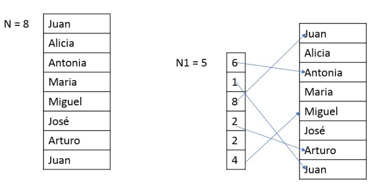

# Parcial #3 · Segunda oportunidad

> **Estructuras Lineales** — Recuperación del examen de estructuras estáticas y dinámicas.

## Planteamiento

Se desea que desarrolle las clases Java necesarias que permitan realizar las siguientes acciones:

1. Definir una **ED estática pila** con capacidad de **N (150 – 300)** elementos de tipo `String`.
2. Llenar la ED con **nombres** generados de manera aleatoria.
3. Definir una **ED estática pila** con capacidad de **N1 (50 – 100)** elementos de tipo `Integer`.
4. Llenar la ED con **valores enteros** generados de manera aleatoria. Estos números representan la **posición** donde se encuentra el nombre que debe ser eliminado.
   > ⚠️ **Restricción:** el contenido de la pila se debe procesar en el orden en que se generó (no se puede ordenar ascendente ni descendentemente).
5. Actualizar la ED pila de nombres **eliminando los nombres** que indican las posiciones de la segunda ED.
   > ⚠️ **Restricción:** las posiciones deben ser con respecto al **estado inicial** de la ED de nombres.

### Ejemplo

  

## Archivos

| Archivo | Descripción |
|---------|-------------|
| [`EDEstatica.java`](EDEstatica.java) | Solución con dos pilas estáticas y eliminación recursiva por posición. |
